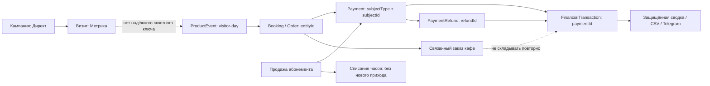

# Бизнес-аналитика: источники, метрики и доступ

## Проверенная база

Основание: main 3ab30cdb (каталог беседок сохранён). Существующий `/admin/analytics` — Яндекс.Метрика/Директ; отдельные отчёты беседок/Плей Парка несопоставимы. Новый экран `/admin/analytics/business` использует существующий модуль analytics. Офисы rental/nedelovoy исключены строгим allowlist gazebos/ps-park/cafe во всех бизнес-запросах, экспортах, сводках. Парковка и сауна: денежного источника нет, показатель недоступен.

## Связи и ограничения

- ProductEvent: funnel + step + sessionKey (посетитель-день, НЕ человек) + entityId. submitted→Booking/Order→Payment (subjectType/subjectId). Нельзя складывать просмотры разных воронок в уникальных посетителей.
- Яндекс.Метрика: визиты, источники, цели. Яндекс.Директ: расход/клики/показы. UTM/кампания не связаны надёжно с Payment: сквозные ROAS/CAC недоступны, CPA цели не равен CAC покупателя. Общесайтовая Метрика включает страницы офисов, поэтому живёт отдельно от бизнес-итогов с явной подписью; новые бизнес-воронки только allowlist.
- Booking(moduleSlug, resourceId, userId, status, startTime/endTime, metadata): дата создания для спроса, startTime для обслуживания. Отмена/NO_SHOW не равны возврату денег. Удалённые брони исключены из операционных метрик, факты денег сохраняются.
- Order(moduleSlug, bookingId, userId, totalAmount, status, paidAt): заказ кафе может входить в счёт сессии. Сумма заказов — спрос, НЕ добавочная касса. Связанный заказ не прибавляется к оплате брони.
- FinancialTransaction: неизменяемая кассовая книга, SESSION_PAYMENT=наличные+терминал; ONLINE_PAYMENT=онлайн, REFUND отрицательный, ADJUSTMENT отдельно. Не складывать с Booking.cash/card, Order.totalAmount или Payment.amount.
- Онлайн-строки леджера проверяются по metadata.paymentId→Payment.isTest=false, RUB и subjectType в BOOKING/ORDER/SUBSCRIPTION; orphan/test/несогласованные строки помечаются и не включаются. Возврат по metadata.refundId; одинаковый payment/refund ID не считать повторно, а показывать нарушение качества.
- Плей Парк: продажа абонемента даёт деньги один раз; списание часов — потребление, не новая оплата. SESSION_PAYMENT для абонемента = 0. Дополнительные товары входят в bill snapshot; без надёжного распределения их нельзя повторно приписывать кафе.
- Ручная предоплата в metadata не является надёжной кассовой записью; отражается как ограничение полноты. Выручка по начислению/прибыль не выводятся без полноценного учёта обязательств и затрат.

## Контракт первой поставки

Период: 7/30/90 завершённых календарных дней Europe/Moscow; полуинтервал [from 00:00+03, next-day 00:00+03). Сравнение с непосредственно предыдущим равным периодом. Деньги в целых копейках при расчётах, RUB на выводе.

Метрики: зарегистрированные поступления, возвраты, нетто движения денег, корректировки отдельно; разрез по 3 направлениям и дням; наличные/терминал/онлайн. Завершённые брони, отмены, NO_SHOW, заказы кафе, связанные заказы (без повторного сложения денег). Повторные клиенты только по известному userId и завершённым операциям; гости отдельно, неизвестная идентичность не выдумывается. Воронка: уникальные visitor-day по шагам, paid по entityId; не обещать когортную конверсию между независимыми окнами. У каждого блока: источник, временная семантика, свежесть, ограничения, ссылка на существующий защищённый раздел.

Не выдавать отсутствие интеграции за ноль. При ошибке БД отчёт не выдаётся. Ошибка рекламного провайдера не ломает кассовую сводку. Пустой период — честные нули и пояснение. Изменение от нулевой базы — абсолютная разница, процент null.

## Доступ и доставка

Business API/page/export: свежая роль из БД ADMIN + явный grant analytics или SUPERADMIN; USER/MANAGER/merged/deleted — отказ. Не менять семантику остальных разделов. Сервис агрегации вызывается только после gate. Ответы private,no-store; без PII, публичных изображений/токенов/ссылок-ключей. CSV только авторизованный fetch, печать графиков из защищённого экрана. На Mini App те же правила через verifyWebAppToken + свежий DB gate.

Недельная подписка по умолчанию OFF: существующая NotificationEventPreference с типом analytics.business_weekly; только свой userId из сессии. Понедельник после 09:00 Europe/Moscow, предыдущие пн–вс. Переключатель и тест в mini app; тест только на telegramId текущего аккаунта и только положительный private chat id с подтверждённым bot contact. Никакой группы или введённого клиентом получателя. Повторная проверка роли/grant/opt-in непосредственно перед отправкой. Durable claim в NotificationLog с детерминированным id на user/week, SENT/FAILED/PENDING; неопределённый исход сетевого запроса не пересылать автоматически (Telegram не даёт idempotency key). AuditLog без финансовых payload и персональных данных. Существующий cron уведомлений вызывает обработчик, новая инфраструктура/секреты/миграции не нужны.

## Проверка

Unit: даты/границы, офисы/test money, refund в другом периоде, дубль webhook ledger, subscription consumption, cafe-linked orders, zero, unknown rows. Security: anonymous/USER/MANAGER/admin без grant/revoked/merged; прямые API/CSV/miniapp/test, чужой recipient в body отвергается. Независимые business-review → designer → code-review/QA. После деплоя HTTP smoke и проверка авторизованных ролей только имеющимися штатными аккаунтами; не выпускать обходные сессии.

## Принятые поправки независимого business-review

1. Ручные продажи абонементов (`Subscription.pricePaid`) и выдача заказов кафе не гарантируют FinancialTransaction: показываем постоянное предупреждение о неполноте каждого направления. Итог называется «Учтённые поступления», никогда «вся выручка».
2. ADJUSTMENT Плей Парка — реальная доплата за товары после завершения: включается в нетто отдельно раскрытым слагаемым: поступления + корректировки − возвраты.
3. Новый отчёт не использует fallback-нули getOverview и UTC-окна getFunnelStats: собственные МСК-запросы, Яндекс-провайдеры независимо с явными available/unavailable.

## Поставка без миграции

Используются существующие NotificationEventPreference и NotificationLog; новых таблиц, аккаунтов, токенов и трекеров нет. Откат — revert feature commit обычным PR и штатный deploy; отключение вызова processWeeklyBusinessReports прекращает будущие отправки, предпочтения/журналы сохраняются. Публичные ссылки на отчёты не создаются. Недоступные production-доступ/браузер должны быть явно отражены в QA, а не заменены фиктивным PASS.
